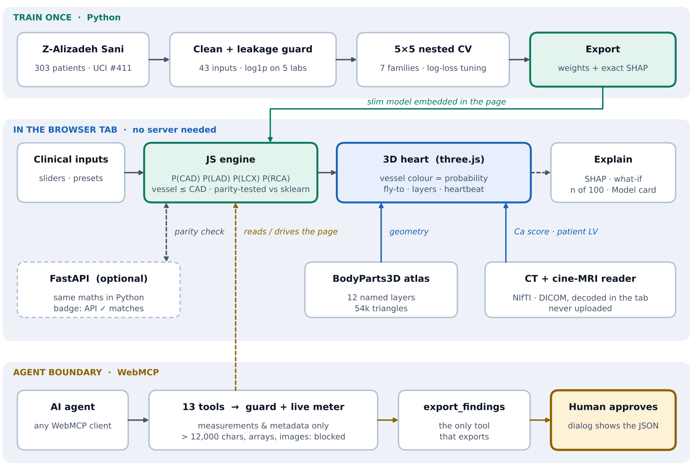

# CardioLens 3D — coronary risk studio

Predict **CAD and LAD / LCX / RCA stenosis probability** from clinical data, see it on an **interactive 3D heart**, understand **why**, and let an
**AI agent drive the whole thing without ever receiving a scan**.
Research prototype for education and decision support. **Not a diagnostic device.** (Built for the Digital Twin Hackathon.)

## Project submission details

| | |
|---|---|
| **Project title** | CardioLens — coronary risk studio |
| **Team details** | **Harsh Yadav**, theharshyadhav@gmail.com |
| **College / incubator** | **Indian Institute of Technology Madras** |
| **Demo video (Unlisted YouTube)** | <https://youtu.be/bZg4DH5eqr8> |
| **Live demo** | **[ADD: deployed URL, if any]** |
| **Open-source licence** | [MIT](LICENSE). Third-party licences: [`THIRD_PARTY_NOTICES.md`](THIRD_PARTY_NOTICES.md) |
| **Architecture diagram (PDF)** | [`docs/CardioLens_architecture.pdf`](docs/CardioLens_architecture.pdf) (also [PNG](docs/architecture.png)) |
| **Presentation (PDF / PPT)** | [`docs/CardioLens_presentation.pdf`](docs/CardioLens_presentation.pdf) · [`docs/CardioLens_presentation.pptx`](docs/CardioLens_presentation.pptx) · light theme for Google Slides: [`.pptx`](docs/CardioLens_presentation_light.pptx) / [`.pdf`](docs/CardioLens_presentation_light.pdf) |
| **Documentation (6 pages)** | [`docs/CardioLens_documentation.pdf`](docs/CardioLens_documentation.pdf) |

> Before submitting: add the live-demo URL if you have one, make the repository public, and open all links in a private window to confirm they work without sign-in.

## Problem statement

Coronary artery disease (CAD) is a leading cause of death. Invasive angiography is the reference test but is costly and not risk-free, and routine clinical risk scores give one bare percentage: they do not say **which artery** (LAD, LCX, RCA) is likely affected, or **why**. Clinicians need a transparent, per-vessel estimate with reasons and honest limits before deciding on further imaging.

## Healthcare use case

* **Triage:** rank patients for CT or angiography from routine clinical data (43 inputs: demographics, risk factors, symptoms, ECG, echo, labs).
* **Shared decision-making:** show a patient which vessel is at risk and what drives it (exact SHAP, what-if curves).
* **Teaching:** explore how age, diabetes or ejection fraction change risk on a 3D heart.
* **Imaging support:** calcium-candidate finder on CT; LV volumes and ejection fraction from cardiac cine MRI.

Research prototype for education and decision support; not a diagnostic device and not a substitute for formal diagnostic imaging or clinical judgement.

## Technical stack

* **Model pipeline (Python):** pandas, scikit-learn 1.9.1, SHAP, nested cross-validation, joblib.
* **App:** one self-contained HTML file; vanilla JavaScript engine (equals scikit-learn to 5.6e-16), three.js r128 (WebGL), BodyParts3D atlas, in-browser NIfTI / DICOM readers.
* **Agent layer:** WebMCP (`document.modelContext`), 13 tools, payload guard, human-approval gate.
* **Backend (optional):** FastAPI + uvicorn; Docker; GitHub Actions; GitHub Pages / Render.
* **Quality:** 490 automated checks (Node + jsdom, Playwright / Chromium, pytest-style API tests).

## AI / ML model details

* **Task:** predict CAD and LAD / LCX / RCA stenosis probability. **Data:** Extension of the Z-Alizadeh Sani data set (UCI #411, 303 patients, 43 inputs).
* **Models compared:** 7 families (logistic regression L1/L2, random forest, gradient boosting, etc.) under 5×5 repeated stratified **nested CV** with log-loss inner tuning. **Exported:** logistic regression (L2 for CAD/LAD/LCX, L1 for RCA) so SHAP is exact and the model runs in the browser.
* **Pooled out-of-fold ROC-AUC (95 % CI):** CAD 0.932 (0.909–0.964) · LAD 0.831 (0.790–0.878) · RCA 0.733 (0.679–0.793) · LCX 0.697 (0.623–0.743). Full tables: [`results/RESULTS.md`](results/RESULTS.md).
* **Safeguards:** outcome columns are never inputs (leakage guard, tested); P(vessel) ≤ P(CAD); calibration checked; limits stated on screen.

## Architecture

PDF version: [`docs/CardioLens_architecture.pdf`](docs/CardioLens_architecture.pdf).

## Quick start

| I want to… | Do this |
|---|---|
| **just use it** | Open **`web/index.offline.html`** in Chrome, Edge or Firefox. It is one self-contained file (anatomy, model, fonts and three.js inside): no install, no network, nothing is uploaded. |
| **run it with the API** | `pip install -r requirements-server.txt` then `uvicorn backend.server:app` → <http://127.0.0.1:8000> (API docs at `/docs`). The page shows an "API ✓ matches" badge when the backend agrees with the in-browser engine. |
| **run it in Docker** | `docker compose up --build` (or `docker build -t cardiolens . && docker run --rm -p 8000:8000 cardiolens`) → <http://localhost:8000> |
| **host it as a static site** | Upload `web/index.offline.html` as `index.html` to any static host (GitHub Pages, Netlify, S3, nginx …). The workflow in `.github/workflows/pages.yml` does this for GitHub Pages. |
| **deploy the container** | `render.yaml` is a ready Render blueprint (Docker, health check `/api/health`). Any platform that runs a Dockerfile works; the container listens on `$PORT` (default 8000). |

Works without a GPU. Tested in Chromium (software WebGL); Safari, Firefox and a physical GPU have not been tested yet.

## What is in the box

| | |
|---|---|
| **Prediction** | Extension of the Z-Alizadeh Sani data set (UCI #411, 303 patients, 43 inputs). 7 model families, 5×5 repeated stratified **nested CV**, log-loss inner tuning. Exported models are logistic regressions, so SHAP is exact and the model runs in the browser. Outcome columns are never inputs (leakage guard, tested). |
| **3D heart** | Real BodyParts3D anatomy (12 named, peelable layers, 54k triangles). The three coronary arteries are the model outputs: colour = predicted probability (teal → amber → red), with text and icon so colour is never the only signal. Click a vessel to fly to it; Solid / Glass / Vessels-only; Layers panel; orientation gizmo; heartbeat at the entered pulse rate; illustrative **Age +20 y** time-lapse. |
| **Interpretability** | Exact SHAP bars per patient, by clinical domain, what-if curves with the out-of-training-range region hatched, "n of 100 patients like this", out-of-range warnings, and an in-app **Model card** (ROC, calibration with Wilson intervals, confusion matrix, limits). |
| **Scan reading room** | Open a CT as NIfTI (`.nii` / `.nii.gz`), as DICOM files / a folder / a `.zip`, or load the synthetic phantom. Decoded **in the tab**, never uploaded; patient tags are never read and file names are never shown. Axial / coronal / sagittal viewer, window presets, HU probe, an adjustable **heart box**, calcium-candidate finder (threshold + 3-D connected components, simplified Agatston-style score), assign each lesion to LAD / LCX / RCA and the 3D chip shows its Ca score. |
| **Cardiac MRI (cine)** | Built-in sample (one Sunnybrook subject, CC0) or your own short-axis cine DICOM files. Traces the left ventricle on every slice and phase and reports **EDV, ESV, SV, EF, heart rate and cardiac output** (sample: EF 41.0 %, EDV 122.3 mL). Tick slices on or off: the numbers update without re-tracing. "My LV" shows the beating ventricle inside the 3D heart (true size, "not an anatomical registration"). It is an **automatic estimate, not validated**; the EF range is a sensitivity range over 5 settings, **not a confidence interval**. |
| **Agent-native (WebMCP)** | 13 tools registered through `document.modelContext` (native if the browser has it, otherwise the bundled polyfill). Tool results are **measurements and metadata only**. A guard checks every result and a live meter on the page shows how many bytes crossed and how many payloads were blocked. `export_findings` is the only tool that moves anything off the page and **blocks until a human approves**. |
| **Works without a GPU** | Software-renderer detection, vertex-lit tissue, time-based resolution governor, a sharp still frame when you stop moving, and zero rendering while idle. Falls back gracefully without WebGL or three.js (the dashboard and the agent tools keep working). |

## Agent tools (`document.modelContext`)

| Tool | Returns (never voxels, never the mesh) |
|---|---|
| `describe_heart_model` | atlas source, size in mm, group names, per-vessel probability and band. States the heart is a generic atlas, not patient-specific |
| `focus_vessel` | moves the 3D view to CAD / LAD / LCX / RCA and returns its probability |
| `describe_scan` | grid, spacing mm, HU range, suggested calcium window |
| `find_calcifications` | regions: mm³, peak / mean HU, extent, centroid mm, Agatston-style score |
| `focus_region`, `set_view`, `assign_vessel` | confirmation + region facts; they only change the viewer |
| `set_heart_region` | sets the heart box (`region: auto / whole` or `box_mm`); returns the box in mm and how many candidates it excludes |
| `describe_cine` | cine MRI size (slices, phases, pixels), heart rate, whether it is measured. No pixels |
| `measure_lv` | EDV / ESV / SV / EF / cardiac output in mL and %, sensitivity ranges, slices used, method sentence ("automatic estimate, not validated"). Optional LV centre re-traces. No contours, no arrays |
| `show_lv_3d` | shows or hides the beating patient LV in the 3D heart; returns its state |
| `predict_risk` | CAD / LAD / LCX / RCA probabilities, top drivers (unknown or outcome keys rejected) |
| `export_findings` | JSON report (schema `cardiolens.room.v2`, with a `cine_mri` block of numbers) **only after the user approves**; cancelled by Deny, by Escape, and automatically if the CT or the cine changes while pending |

Plumbing: one-at-a-time queue, study epoch (stale results dropped), payload guard on every result, error messages that name the next call to make.
Test it from the console: `await navigator.modelContextTesting.executeTool('predict_risk', '{"features":{"age":70}}')`.

## Deployment notes

* **What gets deployed.** `web/index.offline.html` is the page to deploy. `web/index.html` is the same page with three.js loaded from cdnjs (smaller; the browser tests use it). Both are generated by `python build.py`; never edit them by hand.
* **No third-party requests.** Fonts (Public Sans, IBM Plex Mono, SIL OFL) and three.js are inside the file. The server sends a Content-Security-Policy that lets the page talk only to its own origin (`connect-src 'self'`), so scan data and patient numbers cannot leave through the page even if a script were compromised. The only network traffic is the optional `POST /api/predict` with clinical numbers (never scans) when the page is served by the backend.
* **Container.** Multi-stage: the first stage re-proves at every image build that the server's maths equals the scikit-learn pipelines; the runtime image contains only FastAPI + uvicorn and runs as a non-root user with a health check.
* **API hardening.** gzip, request size cap (`CARDIOLENS_MAX_BODY`, default 64 KiB), finite-number validation, no caching of API responses, `nosniff` / `no-referrer`, CORS origins configurable with `CARDIOLENS_CORS_ORIGINS` (default `*`: the API is stateless, read-only and carries no credentials). Patient data is processed in memory only; nothing is stored or logged.
* **Put a reverse proxy / platform TLS in front** for HTTPS (Render, Fly, Cloud Run, Caddy, nginx …) and add rate limiting there if the API is public.
* **API.** `GET /api/health`, `GET /api/schema`, `POST /api/predict` with `{"features": {"age": 66, "dm": 1, ...}}`; missing inputs are imputed and reported, outcome columns are rejected (leakage guard).

## Develop

    make install                  # pip install -r requirements.txt, npm ci, playwright chromium   (or run the three commands by hand)
    make build                    # python build.py  -> web/index.html + web/index.offline.html (also: build.py --check, --artifact)
    make test                     # python tests/run_all.py: 7 suites, about 3 minutes, writes results/test_summary.json
    make test-fast                # Node suites only (about 20 s)

    python cardiolens/benchmark.py     # nested CV, 7 model families x 4 targets -> results/   (≈10 min on 1 CPU)
    python cardiolens/final.py         # final models, calibration check, exact SHAP, figures, web/web_model.json, models/*.joblib
    python -m cardiolens.evidence      # web/evidence.json for the Model card
    python docs/make_pdf.py            # documentation PDF (reads results/ and docs/screens/)
    ./run_all.sh                       # the whole chain above, from the raw spreadsheet to the tests

`docs/DEVELOPMENT.md` explains the architecture, the invariants that must not be broken, the privacy design and the test suites.

| Suite | What it proves |
|---|---|
| `tests/test_parity.js` | the JavaScript engine equals the scikit-learn pipelines (1e-9) and SHAP is additive |
| `tests/test_api.py` | API contract, leakage guard, input hardening, headers, gzip, page served at `/` |
| `tests/test_scan.js` | NIfTI parser and calcium finder against phantom ground truth |
| `tests/test_room.js` | the 13 WebMCP tools, approval gate, epoch cancellation, privacy sweep (jsdom) |
| `tests/test_dicom.js` | DICOM reader and classifier (encodings, hostile input, zip, cine and CT assembly; set `CARDIOLENS_DICOM_DIR` / `CARDIOLENS_DICOM_REF` for the real-file part) |
| `tests/test_cine.js` | cine LV tracer and volumes equal the Python reference to 1e-6; mesh is watertight |
| `tests/test_browser.py` | real Chromium: 3D, hover, fly-to, scan flow, CT / DICOM, MRI, agent gate, layout, no-WebGL, offline page, backend-served page under the CSP |
| `tests/smoke_mri.py` | longer MRI-only Chromium check (not part of `run_all.py`) |

Latest run (2026-10-20): parity 60/60 · api 35/35 · scan 24/24 · room 53/53 · dicom 72/72 · cine 55/55 · browser 191/191 · **490/490 checks** (`results/test_summary.json`).

## Layout

    web/          app.template.html + js/{core,charts,scene,room,cineui,boot}.js + engine.js + scan.js + dicom.js + cine.js + fonts/ + anatomy.b64  ->  build.py  ->  index*.html
    backend/      FastAPI /api/health /api/schema /api/predict and the page at "/" (same maths as the browser engine)
    cardiolens/   data cleaning + leakage guard, model zoo, nested-CV benchmark, final fit / SHAP / export, evidence for the Model card, cine reference tracer
    models/       scikit-learn pipelines (scikit-learn 1.9.1)
    data/ext/     training data: Extension of the Z-Alizadeh Sani data set
    tools/        prep_anatomy.py (BodyParts3D OBJ -> anatomy.b64), make_cine_sample.py, measure_fps.py
    tests/        the suites above + synthetic DICOM / NIfTI generators
    results/      RESULTS.md, metrics.json, cross-validation tables, figures, test summaries
    docs/         CardioLens_documentation.pdf (6 pages), architecture.png, DEVELOPMENT.md, and the scripts that build them
    vendor/       WebMCP core (MIT), bundled into web/webmcp.iife.js

### Adding a structure or a model
* New anatomical structure: add a rule to `RULES` in `tools/prep_anatomy.py` (or drop in another OBJ) and re-run; the viewer iterates over whatever groups the blob contains and the Layers panel lists them automatically.
* New model output on an existing vessel: export it in the same JSON schema; the colour, chip, info card and agent tools read `RS[k].p`.
* New model family: add it to `cardiolens/models.py`; it enters the same nested CV. Only linear models are exported (exact SHAP, runs in the browser).

## Honest limits

* **The heart is a generic adult atlas** (BodyParts3D), not the patient's anatomy. A patient-specific heart needs a segmentation model and a whole-heart CT/MRI training set; this prototype does not do that and says so on screen.
* Single-centre data (303 patients, 71% with CAD), **no external validation**. LCX (AUC 0.70) and RCA (0.73) are only weakly predictable from clinical data; probabilities describe a referral population.
* Tree models are slightly better on some targets (e.g. RandomForest on LCX by +0.014 AUC, within fold-to-fold noise). Linear models were exported for exact SHAP, portability and transparency (`results/RESULTS.md` §3b).
* SHAP and what-if curves are statistical **associations**, not causal effects, and are not mapped onto anatomy (the brief: features are not anatomical coordinates).
* The CT module is a threshold demo: bone, valves and contrast also exceed 130 HU; the Agatston-style score is simplified and **unvalidated**; the heart box is a user-adjusted rectangle (its suggestion is a guess, validated only on synthetic chests), no segmentation, no stenosis measurement. Scan findings are shown beside the clinical model, not fed into it.
* The MRI module is classical contour tracing, an **unvalidated automatic estimate** with no manual contours to compare against; basal slices are left out and papillary muscles count as cavity, so volumes may be underestimated. Short-axis bright-blood cine only. The MRI EF stands in for the echo EF the risk model was trained on. The sample subject is a 27-year-old, outside the model's training ages, so his coronary-risk numbers do not apply.
* Tested in headless Chromium with software WebGL. Not yet tested on Safari, Firefox or a physical GPU.

## Credits and licences

Every bundled component and data set, with its licence and the attribution it needs, is listed in [`THIRD_PARTY_NOTICES.md`](THIRD_PARTY_NOTICES.md).
In short: clinical data Extension of Z-Alizadeh Sani (UCI #411, CC BY 4.0) · 3D anatomy **BodyParts3D © The Database Center for Life Science, CC BY-SA 2.1 Japan**
(the derived `web/anatomy.b64` is therefore distributed under the same licence) · cine MRI sample from the Sunnybrook Cardiac Data (CC0) · WebMCP core, three.js (MIT) ·
Public Sans and IBM Plex Mono (SIL OFL 1.1).

**Project licence:** MIT, see [`LICENSE`](LICENSE).
